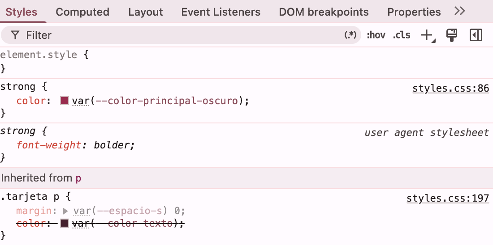
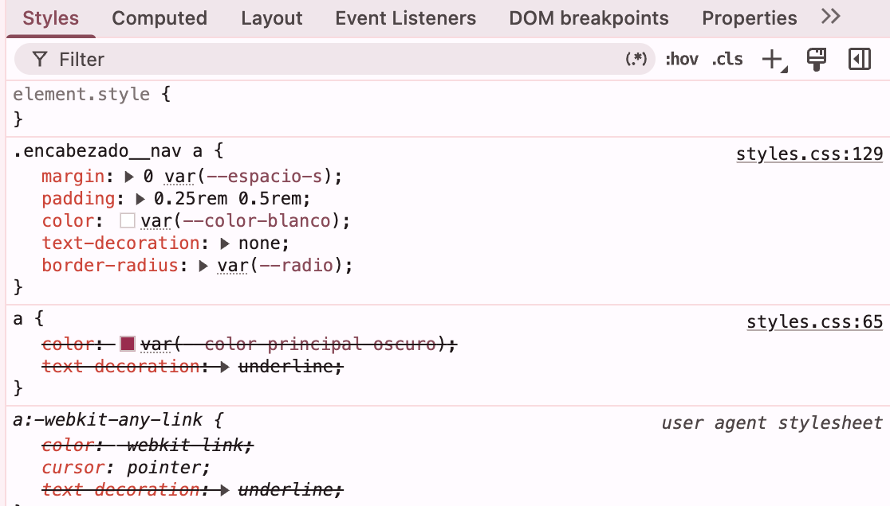
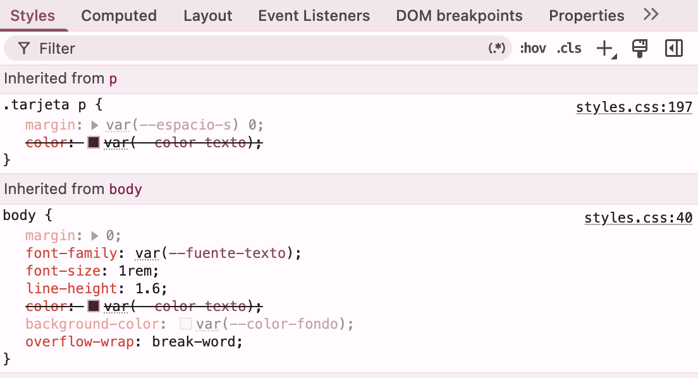

# Librería Saretta · Proyecto HTML y CSS

Sitio web de dos páginas para una papelería de barrio (negocio ficticio), hecho con HTML y CSS.

---

## 1. El proyecto

**Negocio:** Librería Saretta, una papelería ficticia que vende libretas, lapiceros Sanrio y artículos escolares con estilo "cute".

**Para quién es el sitio:** para estudiantes y personas del barrio que buscan papelería bonita y no quieren esperar a que alguien les responda por WhatsApp o Instagram.

**Qué necesita el cliente:**
- Mostrar sus productos y sus precios en un solo lugar.
- Informar horarios y cómo llegar.
- Que los clientes puedan hacer un pedido desde el celular.
- Transmitir confianza con opiniones de otros clientes.

Todos los datos (nombre, precios, horarios) son inventados.

---

## 2. Estructura

```
Taller-Html-y-CSS/
├── index.html
├── precios.html
├── README.md
├── css/
│   └── styles.css
├── images/
├── video/
└── capturas/
```

- `index.html`: presentación, productos (3 tarjetas), horarios en lista, opiniones y cómo llegar.
- `precios.html`: tabla de precios y formulario de pedido.
- `css/styles.css`: una sola hoja de estilos que usan las dos páginas.
- `images/` y `video/`: fotos y multimedia del sitio.
- `capturas/`: imágenes que usa este README.

### Etiquetas semánticas que elegí

| Etiqueta | Dónde la uso | Por qué |
|---|---|---|
| `header` | Arriba de las dos páginas, con el nombre y el menú | Es la cabecera del sitio, igual en las dos páginas |
| `nav` | Dentro del `header`, con los enlaces a Inicio y a Productos y precios | Agrupa los enlaces de navegación |
| `main` | Contiene todo el contenido propio de cada página | Solo hay uno por página y lo distingue del encabezado y el pie |
| `section` | Productos, horarios, opiniones, cómo llegar, precios y pedido | Cada una es un tema con su propio título `h2` |
| `article` | Cada tarjeta de producto | Cada producto se entiende por sí solo, aunque se sacara de la página |
| `blockquote` + `cite` | Las opiniones de clientes | Son citas de otras personas y `cite` nombra al autor |
| `footer` | Abajo de las dos páginas | Cierra el sitio con los datos finales |

Cada página tiene un solo `h1` (el nombre de la librería) y los títulos de las secciones son `h2`.

Ejemplo de mi código:

```html
<section class="seccion" id="productos">
  <h2>Nuestros productos</h2>
  <article class="tarjeta tarjeta--promo">
    <h3>Libretas de 100 hojas</h3>
    <p>Antes: <s>$15.000</s> <br> Ahora: <strong>$12.000</strong></p>
  </article>
</section>
```

---

## 3. Sistema visual

Todo el color, la tipografía y los espacios están en variables dentro de `:root`, y las uso en toda la hoja. Si el cliente quiere cambiar la paleta, solo se modifican en un lugar.

```css
:root {
  --color-fondo: #fff0f5;
  --color-principal: #d6336c;
  --color-principal-oscuro: #a61e4d;
  --color-acento: #f783ac;
  --color-texto: #4a1f2f;
  --fuente-titulos: Georgia, "Times New Roman", serif;
  --fuente-texto: "Trebuchet MS", Arial, sans-serif;
  --espacio-m: 1rem;
  --radio: 0.75rem;
}
```

**Por qué las elegí:**
- **Paleta rosada:** va con una papelería "cute" y se reconoce de inmediato. Tiene un rosa fuerte para botones y encabezados, un rosa oscuro para títulos y un rosa suave para fondos.
- **Texto vinotinto oscuro (`#4a1f2f`)** sobre fondo rosado muy claro: se lee bien sin usar negro puro.
- **Georgia para los títulos y Trebuchet MS para el texto:** dos fuentes distintas, ambas con fuente de respaldo (`serif` y `Arial, sans-serif`) por si el equipo del visitante no las tiene.
- **Espacios en `rem`:** se ajustan si el usuario cambia el tamaño de letra de su navegador.
- **`--radio`:** un mismo borde redondeado para tarjetas, formulario y campos, para que todo se vea coherente.

También uso colores con canal alfa, por ejemplo `--color-sombra: rgba(166, 30, 77, 0.25)`, para las sombras de las tarjetas.

---

## 4. Especificidad

La especificidad se calcula como **(IDs, clases, etiquetas)** y se compara de izquierda a derecha.

### Conflicto 1: el precio de la tarjeta

Reglas que compiten sobre el mismo `<p class="tarjeta__precio">`:

```css
.tarjeta p                  → (0,1,1)  color: var(--color-texto)
.tarjeta .tarjeta__precio   → (0,2,0)  color: var(--color-principal-oscuro)
```

Gana `.tarjeta .tarjeta__precio` porque tiene 2 clases contra 1 clase y 1 etiqueta. No importa que esté antes o después en el archivo. Si hubiera escrito solo `.tarjeta__precio` (0,1,0), habría perdido contra `.tarjeta p`.
<br> <br> 


<br>

### Conflicto 2: los enlaces del menú

Reglas que compiten sobre cada `<a>` dentro del `nav`:

```css
a                    → (0,0,1)  color: var(--color-principal-oscuro)
.encabezado__nav a   → (0,1,1)  color: var(--color-blanco)
```

Gana `.encabezado__nav a` porque tiene 1 clase contra 0 clases. Es necesario, porque el encabezado tiene fondo rosado oscuro y el color general de los enlaces no se leería.
<br> <br>


### Conflicto 3: la tarjeta en promoción (empate resuelto por orden)

Reglas que compiten sobre `<article class="tarjeta tarjeta--promo">`:

```css
.tarjeta         → (0,1,0)  background-color: var(--color-blanco)
.tarjeta--promo  → (0,1,0)  background-color: var(--color-fondo-suave)
```

Las dos tienen la misma especificidad (1 clase). Gana `.tarjeta--promo` porque está escrita **después** en `styles.css`. Si la moviera antes de `.tarjeta`, perdería y la tarjeta en promoción se vería blanca.

<br> <br>


---

## 5. Herencia

**Una propiedad que se hereda: `color` (y `font-family`).** Las escribí solo en `body`, y los `p`, `li` y `td` las toman de ahí sin que yo les ponga nada. Se nota en los textos de los horarios y en las celdas de la tabla: tienen la misma fuente y el mismo color vinotinto.

```css
body {
  font-family: var(--fuente-texto);
  color: var(--color-texto);
}
```

**Una propiedad que no se hereda: `border`.** La tarjeta tiene un borde rosado, pero el `h3`, el `p` y la imagen que están dentro no lo tienen. Lo mismo pasa con `background-color`: el fondo blanco de `.tarjeta` no pasa a sus hijos.

**Un caso curioso:** los campos del formulario y el botón no heredan la fuente del `body`, porque el navegador les pone la suya. Por eso agregué `font: inherit` en `.formulario input`, `.formulario textarea` y `.boton`. Los enlaces tampoco toman el color del `body`, por eso tienen su propia regla `a`.

---

## 6. Modelo de cajas

### Ancho total de `.tarjeta`

```css
.tarjeta {
  max-width: 25rem;
  padding: 1rem;
  border: 2px solid var(--color-borde);
}
```

Con `box-sizing` por defecto (`content-box`) y 1rem = 16 px:

| Parte | Cálculo | Valor |
|---|---|---|
| Contenido | 25rem × 16 | 400 px |
| Padding (izquierda + derecha) | 16 + 16 | 32 px |
| Borde (izquierdo + derecho) | 2 + 2 | 4 px |
| **Ancho total** | 400 + 32 + 4 | **436 px** |

Esto es en pantalla grande. En el celular `max-width` es solo un límite: la tarjeta ocupa el espacio que haya.

En cambio, los campos del formulario usan `box-sizing: border-box`. Así su `width: 100%` ya incluye padding y borde, y no se salen de la pantalla.

### Márgenes que se solapan

Cada tarjeta tiene `margin: 1.5rem auto`. Entre dos tarjetas seguidas, el margen de abajo de la primera (24 px) y el de arriba de la segunda (24 px) **no se suman**: se solapan y la separación real es de **24 px**, no de 48 px.

---

## 7. Selectores

Mi pseudoclase estructural está en la tabla de precios:

```css
.tabla tbody tr:nth-child(even) {
  background-color: var(--color-fondo-suave);
}
```

Cómo funciona: dentro del `tbody` hay 3 filas `tr` hermanas. `:nth-child(even)` las cuenta por su posición (1, 2, 3) y se aplica a las que ocupan lugar par. Termina aplicando solo a la **fila 2** (la de la libreta grande), que se pinta de rosado suave. La 1 y la 3 quedan blancas.

`:nth-child` cuenta a todos los hermanos sin importar su etiqueta, y también los que están ocultos con `display: none`, porque siguen en el HTML.

También uso:
- **Selector de atributo:** `.formulario input[required]` marca con una franja rosada los campos obligatorios, y `a[target="_blank"]::after` agrega una flecha solo a los enlaces que abren en otra pestaña.
- **Combinador descendiente:** `.encabezado__nav a` (los enlaces dentro del menú).
- **Pseudoelementos:** `.seccion h2::before` agrega una flor antes de cada título, y `.opinion__autor::before` agrega la raya antes del nombre del cliente.

---

## 8. Responsive

Las dos páginas tienen `<meta name="viewport" content="width=device-width, initial-scale=1.0">`. Además, mi `@media (max-width: 480px)` cambia esto:

```css
@media (max-width: 480px) {
  body { font-size: 0.95rem; }
  .encabezado__titulo { font-size: 1.4rem; letter-spacing: 0.08em; }
  .encabezado__nav a { display: block; margin: 0.25rem 0; }
  main { padding: var(--espacio-s); }
  .tarjeta { padding: var(--espacio-s); }
}
```

- **Título más pequeño y con menos espacio entre letras:** el nombre de la librería, en mayúsculas y con mucho `letter-spacing`, no cabía en 360 px.
- **Enlaces del menú uno debajo del otro:** son más fáciles de tocar con el dedo.
- **Menos padding en `main`, secciones, tarjetas y formulario:** se gana espacio horizontal para el contenido.
- **Mapa más bajo (12rem):** no ocupa toda la pantalla.

---

## 9. Problemas y soluciones

### Problema 1: el formulario se veía sin estilos

- **Qué pasaba:** el CSS estaba enlazado y el encabezado sí se veía rosado, pero en `precios.html` las etiquetas y los campos aparecían todos en una línea, con el estilo gris del navegador.
- **Por qué:** mis reglas son `.formulario`, `.boton` y `.tabla`, y esas reglas solo se aplican a elementos con esa clase. Mi `<form>` y mi `<button>` no tenían `class`.
- **Cómo lo arreglé:** agregué `class="formulario"` al `form` y `class="boton"` al botón, y envolví el contenido en `<main>`.

### Problema 2: el enlace "Productos y precios" no abría la página

- **Qué pasaba:** al hacer clic en el enlace, la vista previa de VS Code mostraba "Failed to Load Page" con el error `ERR_UNEXPECTED (-9)`.
- **Por qué:** el enlace estaba bien escrito (`href="precios.html"`). El problema era el visor integrado de VS Code, que falla al navegar entre archivos con `file:///`.
- **Cómo lo arreglé:** abrí el sitio con Live Server (botón "Go Live"), que lo muestra desde `http://127.0.0.1:5500/` en el navegador normal.

---

## 10. Capturas

### Escritorio

| `index.html` | `precios.html` |
|---|---|
|  |  |

### Celular (360 px de ancho)

| `index.html` | `precios.html` |
|---|---|
|  |  |
---
